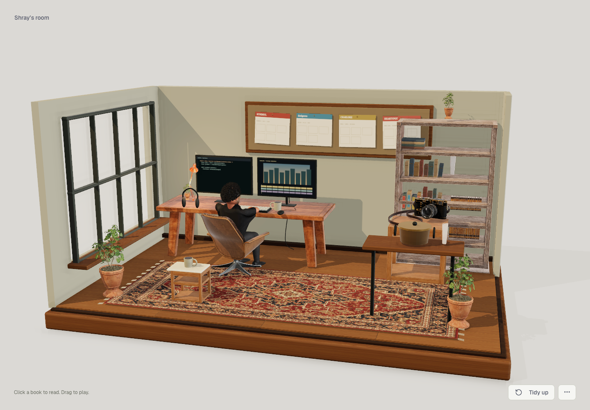
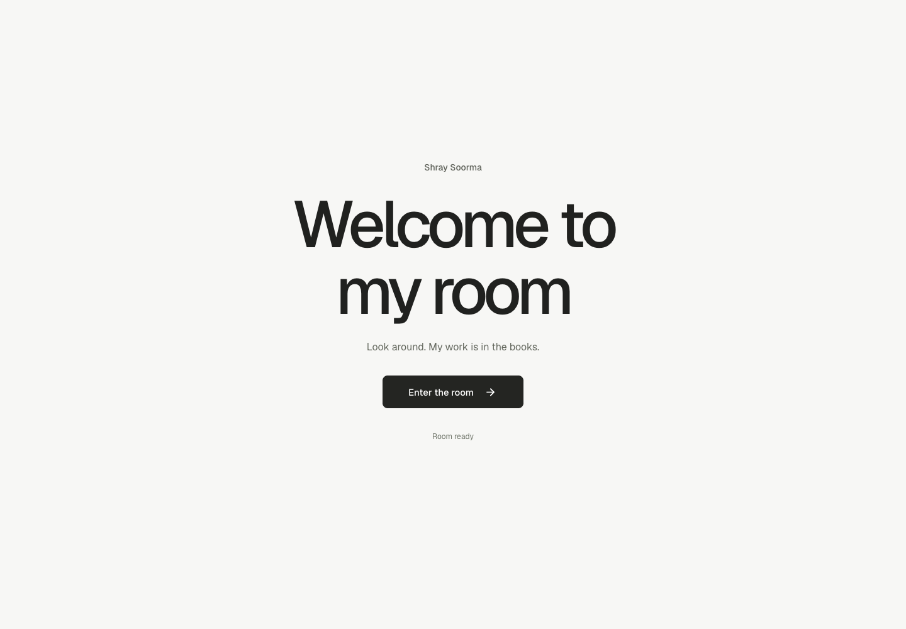

# Shray Soorma — The Studio

One interactive personal studio, bringing engineering, design, storytelling, and home cooking into the same space. The main page renders real geometry with textured furniture and a portrait-derived miniature of Shray.



## Preview

```sh
python3 -m http.server 4173
```

Open http://localhost:4173. `index.html` and `house.html` open the same studio. The checked-in browser assets run without a build step, backend, audio, or external runtime service.

## UI development



The interface uses Web Awesome components, Lucide icons, and Geist typography. Buttons, the room menu, progress, and readers use library components with keyboard and focus behavior. All UI assets are hosted locally; there are no runtime CDN or font requests. Source versions and licenses are in `assets/ui/SOURCES.json`.

```sh
npm ci
npm run build:ui
npm run test:ui
```

The UI build bundles only the imported components. The Playwright checks use locally installed Google Chrome and include axe accessibility checks, loading and failure states, keyboard entry and menus, focus return, book click/drag behavior, and mobile layout.

## Explore

- A dedicated **Welcome to my room** screen loads the scene in the background. **Enter the room** reveals it when ready; the routine and rendering loop stay idle until entry. The **•••** menu holds camera views, pause, lighting, routine, and render quality; keys 1–3 still select the views.
- Drag loose objects to pick them up; flick before releasing to throw. Right drag or drag an empty area to turn the camera. Scroll to zoom.
- On touch, drag to grab; use two fingers to turn and pinch to zoom.
- The Persian rug has 325 cloth particles. Lift an edge to fold and drape it.
- Miniature Shray follows authored animation until grabbed. Touching him activates a loose, connected ragdoll; Tidy up animates him back into his seated pose and resumes the routine.
- Click a book to read the portfolio. Kyndryl, dezignrco, Charlore, and HeartyPot have labeled volumes on the shelf; the notebook holds personal notes, education, and contact links. Dragging past a small threshold picks a book up instead of opening it. Hovering shows no cards or object highlights. A keyboard-accessible **Bookshelf** is available in the room menu.
- **Tidy up** or R floats and rotates displaced objects back into place over about 2.3 seconds, including the cloth and character pose. **Pause** or Space freezes physics and monitor animations.
- **Routine on/off** controls autonomous activity. Picking up the figure, its carried prop, or essential furniture suspends the routine; **Tidy up** restarts it. **Pause** freezes the routine, physics, and screens together.
- **Evening** changes the lighting; **Native quality / Balanced** switches render resolution and contact shading.

Camera URLs are `#studio`, `#me`, and `#workbench`. Previous house URLs open the consolidated studio.

## The room

Scanned furniture supplies worn timber, leather folds, book bindings, ceramics, articulated lighting, and foliage. Additional modeled details include an open notebook, keyboard, headphones, cables, cooking pot, project cards, shelves, and individual reference volumes. Fifty-seven loose objects are registered with the physics world. Architecture and the wall-mounted pinboard remain fixed.

The miniature follows a varied daily routine: type, stand up, walk to the bookshelf, take a real shelf book into the open room, read and turn a page, close and return it, or take a coffee break with the actual cup. Reading and sipping face the main camera. Activity selection and dwell times vary; reading lasts roughly 4–9 seconds. The chair swivels outward before he steps away and returns with him as he sits. Keyboard-aligned palm targets keep typing wrists straight while individual fingers tap the keys. Book and cup pickups establish hand contact before lifting; supported placement finishes before the fingers release. Reading uses two-hand support and a finger/thumb pinch to turn a flexible page. The Charlore screen animates an episode timeline. Both are explanatory local exhibits; neither calls production services. Project records come from `scripts/data.js`, including HeartyPot’s **in build** status.

The character uses an anatomical base with a 163-bone skeleton, articulated fingers, separate clothing, modeled curls, and ten authored animation clips. The original portrait supplies the pose-corrected facial surface, welded to a rounded cranium with a modeled chin, jaw underside, and temples; the supplied turnaround guides clothing and proportions. Unseen angles are inferred, so this is a reference-fitted miniature rather than a 3D scan. `character.html` provides a rotatable model and animation inspection view, with a separate face close-up.

`tools/build_reference_character.py` rebuilds `assets/studio/character/shray-character.glb` and the editable, packed Blender source at `.studio-build/shray-reference-character.blend`. Private portrait references and working sources are excluded from version control. The anatomical base, skeleton, and weights are CC0 MakeHuman core assets; provenance is recorded in `assets/studio/character/SOURCES.json`.

## Rendering and physics

A perspective camera supports close inspection without raster-background enlargement. Local environment lighting, shadow maps, material textures, depth-based contact shading, and high-DPI output provide surface detail. Native quality renders at the display’s full pixel ratio, constrained only by the GPU’s framebuffer and viewport limits; Balanced caps it at 1.25 and disables contact occlusion. Animation uses the browser’s display-synchronized frame callbacks without an application FPS cap. Monitor textures render at 2048×1280; the timeline cursor moves as GPU geometry each frame, and the code texture updates when its text or caret changes. Hardware-supported texture anisotropy and multisample antialiasing are enabled. Hidden tabs suspend simulation and screen updates.

Dragging updates the held point directly without repeating scene picking. Character picking uses the animated collision sections instead of the dense skinned mesh. Rug constraints enter the physics world when the rug is grabbed and are removed on restoration.

Props activate when grabbed or meaningfully struck by a moving object. Light resting contacts do not wake the room. A dragged piece of furniture can push objects that were resting against it, even while its movement is initially blocked. Momentum thresholds keep tiny objects from launching heavy furniture; damping, limited grab forces, and velocity caps keep collisions controlled. Grabbing a rug or the character activates the cloth or the articulated figure. The miniature starts seated at the workbench with hands toward the keyboard. Rigid props use approximate box or compound colliders. Cloth has structural and shear constraints with bend springs; cloth self-collision is not modeled, so folded layers may intersect. The character has fifteen physical segments and fourteen cone/twist joints. Bodies and joints stay outside the physics world until he is grabbed. Activation captures his current animated pose and drives the existing weighted skeleton; his arms and legs then move independently while staying connected. Tidy up removes the physics bodies and blends the bones back into the seated pose. The reference-fitted head includes a measured facial surface and a textured undercoat and fine, tapered curl clumps. Autonomous walking uses planted support feet, straighter knees, relaxed arm swings, consistent elbow bend planes, and smooth transitions; scripted walking does not shove furniture. Picking up the figure suspends the routine and activates the ragdoll where he currently is, without snapping him back to the desk. Collision geometry approximates the scanned surfaces and can show intersections during rough play.

Work and profile records remain accessible when WebGL is unavailable. The page provides keyboard-accessible dialogs and an object list in addition to direct picking.

## Files and sources

- `scripts/studio-shell.js`: welcome gate, component menu dispatch, loading progress, and dialog focus return.
- `scripts/ui-components.js`, `tools/build-ui.mjs`: library imports and reproducible self-hosted UI bundle.
- `scripts/studio-app.js`: camera views, input, rendering, work records, and fallback.
- `scripts/personal-studio.js`: architecture, furniture, props, cloth, and animated screens.
- `scripts/character-hands.js`: palm targets, stable arm IK, constrained finger grips, page pinching, and keyboard contact.
- `scripts/reference-character.js`: skeletal animation mixing, hand/mouth anchors, and compound collider mapping.
- `scripts/character-viewer.js`, `character.html`: standalone model and animation inspection.
- `tools/build_reference_character.py`: reference fitting, garments, texture baking, rig, and animation export.
- `assets/studio/character/`: browser model, measured anatomy, textures, and source licenses.
- `scripts/studio-routine.js`: varied activity scheduling, navigation, chair clearance, supported prop handling, interruption, and return to work.
- `scripts/room-physics.js`, `scripts/ragdoll-physics.js`, `scripts/skeletal-ragdoll.js`, `scripts/soft-rug.js`: simulation and reset.
- `styles/personal-studio.css`: responsive studio interface.
- `assets/studio/models/SOURCES.json`: new scanned assets and CC0 source links.
- `assets/studio/SOURCES.json` and `assets/world/SOURCES.json`: lighting, materials, libraries, and licenses.

Earlier desktop, illustration, and multi-room prototypes remain as development history; the main page does not load them.

## Validation

Browser checks cover the single room, all three camera views, 57 movable objects, the 325-node rug, the touch-activated articulated miniature, actual pointer grabbing and throwing, whole-character stability, animated restoration, full book/coffee routines, exact prop returns, planted steps, unobstructed reading, cup-to-mouth alignment, ragdoll activation during walking, seated typing, screen animation and pause, four work records, mobile layout, and WebGL fallback. Broader physical-device and cross-browser performance checks remain separate work.
